

  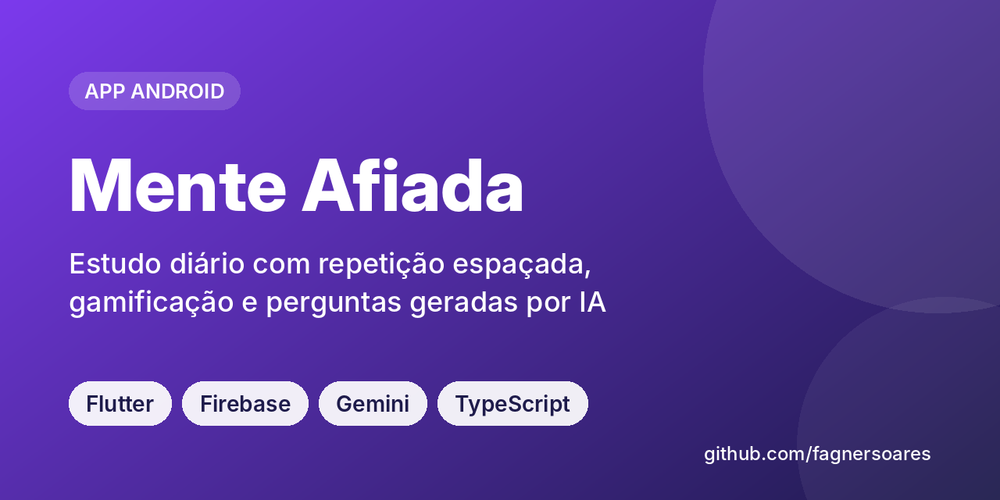

  
  
  
  
  
  

#  Mente Afiada

App Android para **estudar alguns minutos por dia**. O usuário responde a uma sessão curta de perguntas; as que errou voltam em intervalos crescentes (**repetição espaçada**), cada acerto rende **XP, sequência de dias, conquistas** e pontos na **liga semanal**. Novas perguntas são **geradas por IA**, validadas automaticamente e só entram no app depois de revisadas por um administrador. Para **inglês**, além da múltipla escolha, há exercícios de **audição, ditado e escrita**.

> Esta é a **vitrine pública** do projeto: funcionalidades, arquitetura e telas. O código-fonte fica em um repositório privado.

## Telas

| Login | Início | Sessão de estudo |
| :---: | :---: | :---: |
|  | 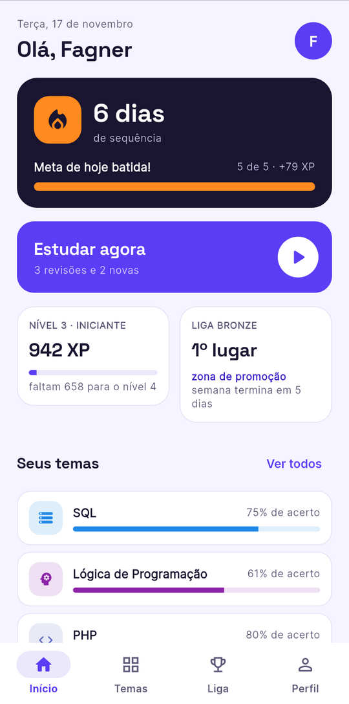 | 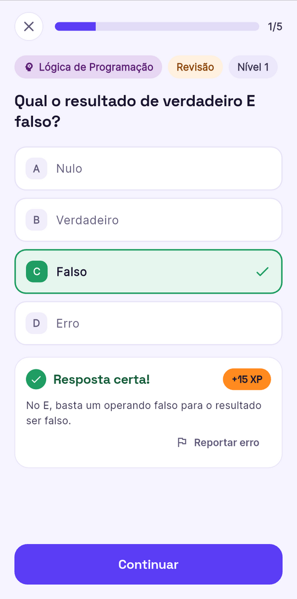 |
| **Inglês: ouvir e escolher** | **Inglês: escrita** | **Resultado** |
| 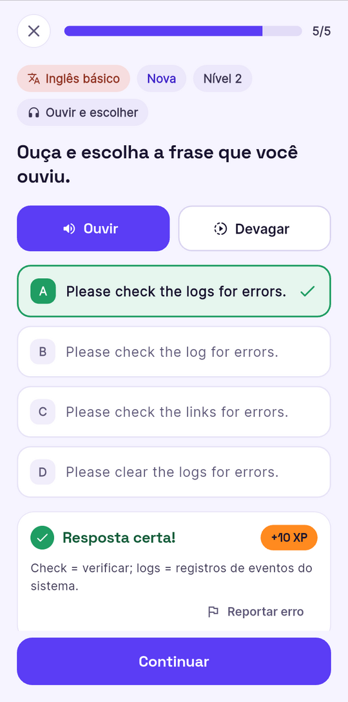 | 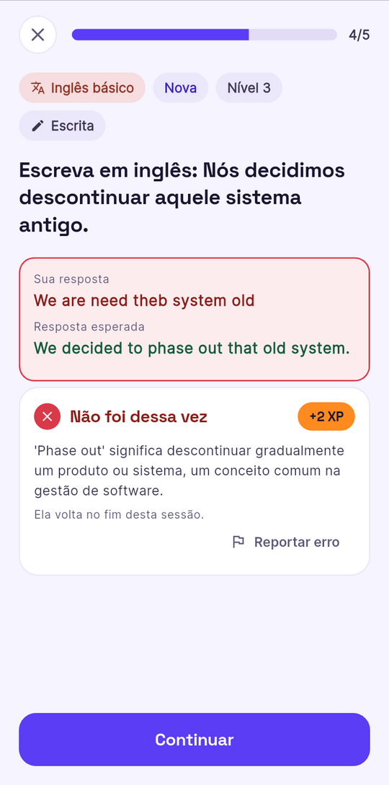 | 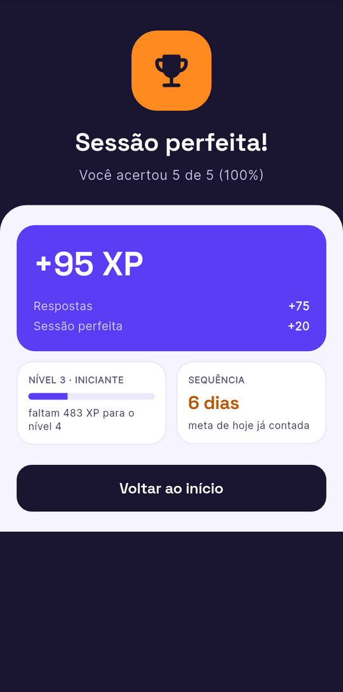 |
| **Liga semanal** | **Perfil e conquistas** | **Painel do admin** |
| 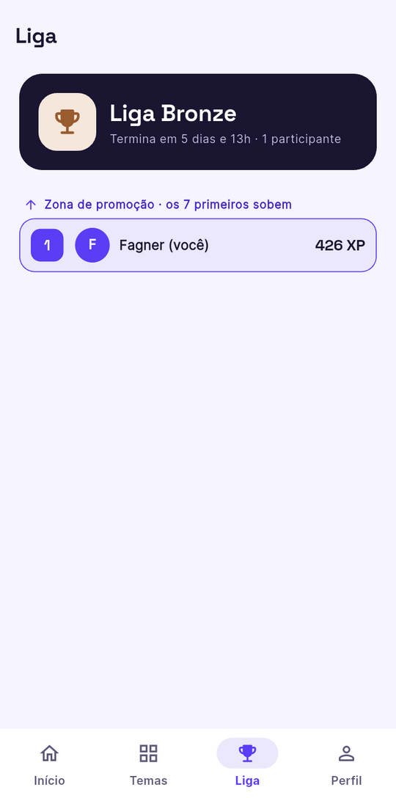 | 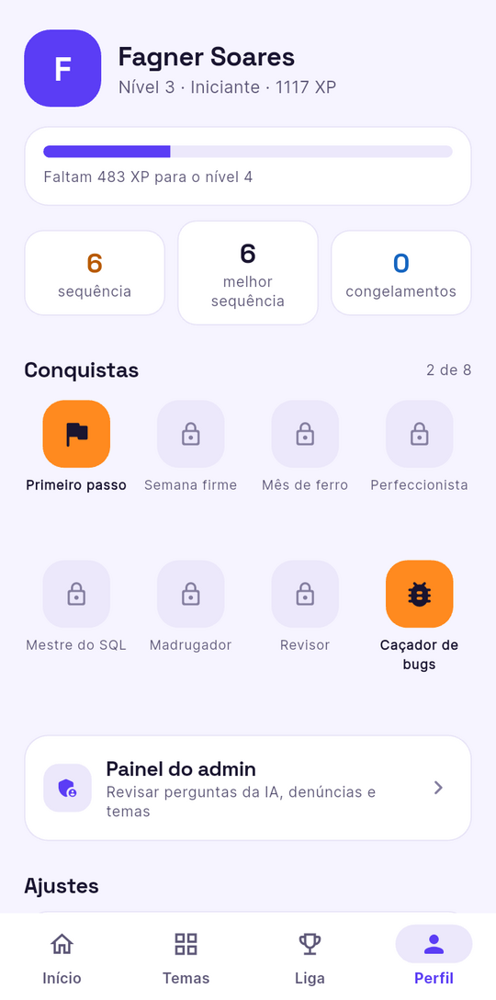 | 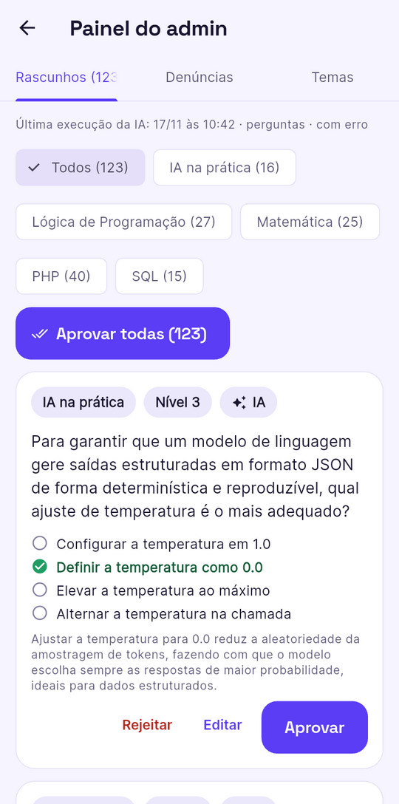 |

## Destaques técnicos

- **Custo zero de infraestrutura:** roda no plano gratuito do Firebase. O que seria Cloud Function virou validação nas **regras do Firestore** e **scripts agendados** no computador do administrador.
- **Anti-trapaça sem servidor:** o app calcula XP, revisão e sequência, e as regras do Firestore conferem cada valor no mesmo lote de escrita: a resposta contra a pergunta real, o XP pela tabela, a transição da caixa de revisão, o bônus de meta uma vez por dia e o XP da liga junto com o XP total.
- **Multiusuário seguro:** dados por usuário nas regras; papel de administrador por *custom claim* do Firebase Auth, nunca por um campo editável.
- **Sem segredos no repositório:** chave da IA só em variável de ambiente da máquina que gera as perguntas; configuração do Firebase e chave da conta de serviço fora do Git.
- **IA com controle de qualidade:** validação automática (4 alternativas distintas, resposta válida, explicação, frases curtas por nível, sem duplicatas parecidas), fila de aprovação do admin, botão "Reportar erro" e teto de custo semanal.
- **Mesma regra em dois lugares, testada uma vez:** a normalização das respostas digitadas existe em Dart (app) e TypeScript (scripts) e as duas são testadas com o mesmo arquivo de casos.

## Funcionalidades

| Área | O que faz |
| --- | --- |
| Conta | Login com e-mail/senha ou Google; exclusão de conta com remoção de todos os dados |
| Primeiro acesso | Escolha de temas, meta diária (5, 10 ou 15 perguntas) e horário do lembrete |
| Estudo | Sessão curta, uma pergunta por vez, feedback imediato e explicação; a pergunta errada volta no fim da sessão |
| Repetição espaçada | Caixas de Leitner: revisão em 1, 3, 7, 14 e 30 dias; até 60% da sessão em revisões |
| Níveis por tema | Nível seguinte liberado com mais de 70% de acerto |
| Inglês | Múltipla escolha, **ouvir e escolher**, **ditado** e **escrita**, com voz do próprio Android, botão "Devagar" e dica |
| Gamificação | XP, níveis, sequência com congelamento, conquistas e ligas Bronze → Diamante |
| Ligas | Grupos semanais de até 30 pessoas; os 7 primeiros sobem, os 5 últimos descem |
| Lembretes | Notificação local no horário escolhido e aviso de sequência em risco (no máximo 2 por dia) |
| Conteúdo por IA | Meta de 50 perguntas por tema, geração semanal e sugestão mensal de temas, sempre como rascunho |
| Administração | Painel no app: aprovar, editar ou rejeitar perguntas (inclusive em lote), tratar denúncias e aprovar temas |

Temas: **SQL**, **Lógica de Programação**, **PHP**, **Inglês para TI**, **IA na prática** e **Matemática**.

## Arquitetura

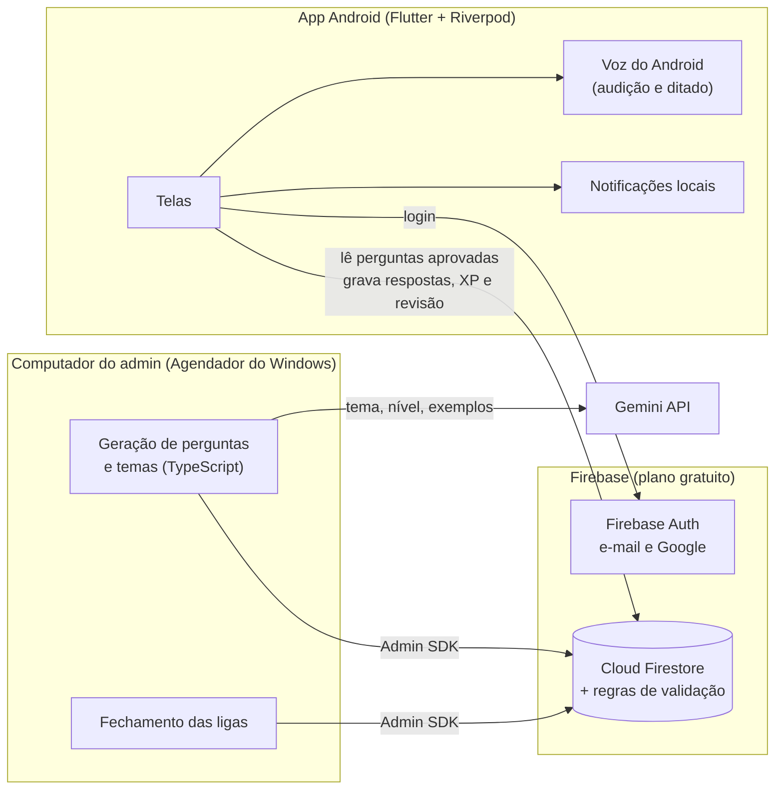

### Geração de perguntas por IA

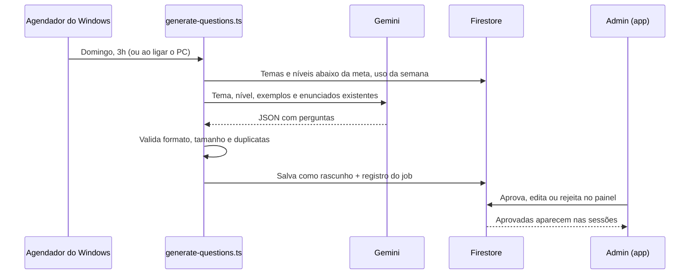

## Modelo de dados (Firestore)

| Coleção | Conteúdo |
| --- | --- |
| `topics` | Temas: nome, ícone, cor, status (rascunho/aprovado), origem |
| `questions` | Tipo, enunciado, alternativas ou respostas aceitas, frase falada, explicação, nível, status, denúncias |
| `questions/{id}/reports` | Uma denúncia por usuário |
| `users/{uid}` | Perfil, meta, temas, XP, nível, sequência, liga |
| `users/{uid}/reviews` | Fila da repetição espaçada (caixa e próxima revisão) |
| `users/{uid}/answers` | Histórico de respostas — base para um dashboard de evolução |
| `users/{uid}/achievements` | Conquistas desbloqueadas |
| `leagues/{id}/members` | Grupos semanais por divisão e XP da semana |
| `generationJobs` | Auditoria e controle de custo da geração por IA |

## Gamificação

| Ação | XP |
| --- | --- |
| Acerto em pergunta nova | 10 |
| Acerto em revisão | 15 |
| Erro (leu a explicação) | 2 |
| Meta do dia batida | +30 |
| Sessão perfeita | +20 |
| Bônus de sequência | +10% por semana, até +50% |

Nível *n* exige 100 × *n*² XP. Conquistas como "Primeiro passo", "Madrugador" e "Caçador de bugs" (ter uma denúncia de erro confirmada pelo admin).

## Stack

| Camada | Tecnologia |
| --- | --- |
| App | Flutter, Dart, Riverpod, Material 3 |
| Autenticação | Firebase Auth (e-mail e Google) |
| Banco | Cloud Firestore com regras de segurança e validação |
| Scripts | Node.js 22 + TypeScript (Admin SDK), agendados no Windows |
| IA | Gemini API |
| Voz | Text-to-speech do Android (`flutter_tts`) |
| Notificações | `flutter_local_notifications` |
| Testes | `flutter_test`, `node:test` |

## Roteiro

- [x] **Fase 1 — Base:** projeto Flutter, Firebase, login, boas-vindas, regras de segurança e banco inicial de perguntas
- [x] **Fase 2 — Estudo:** sessão de perguntas, gravação das respostas, repetição espaçada e tela de temas
- [x] **Fase 3 — Gamificação:** XP validado pelas regras, níveis, sequência, conquistas, resultado e perfil
- [x] **Fase 4 — Social e lembretes:** ligas semanais, ranking e notificações locais
- [x] **Fase 5 — IA:** geração agendada, painel do admin e denúncias
- [x] **Fase 6 — Perguntas mais difíceis e inglês:** níveis mais exigentes, audição, ditado e escrita
- [ ] Publicação na Google Play (teste fechado) e dashboard de evolução com os dados de `answers`

## Autor

**Fagner Soares** — Desenvolvedor de Sistemas · Salvador, BA
[github.com/fagnersoares](https://github.com/fagnersoares)

O código-fonte é privado; posso apresentá-lo em entrevistas ou sob solicitação.
