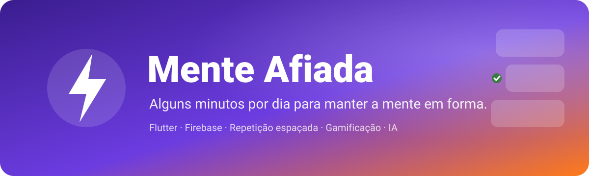
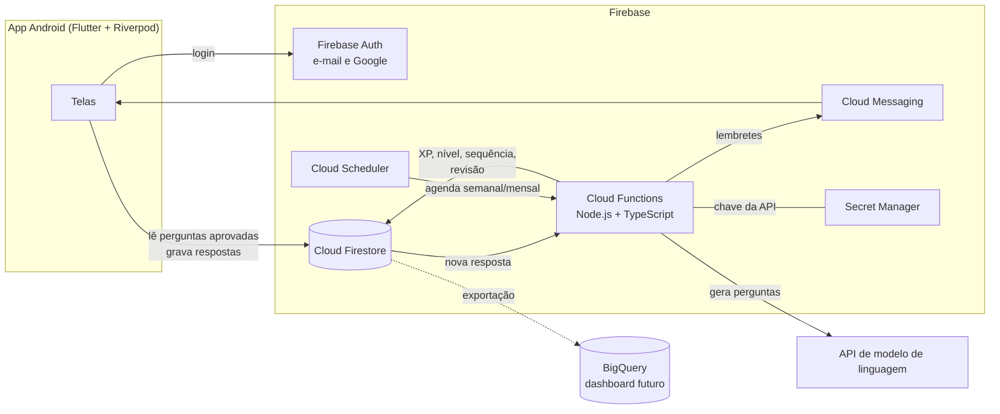
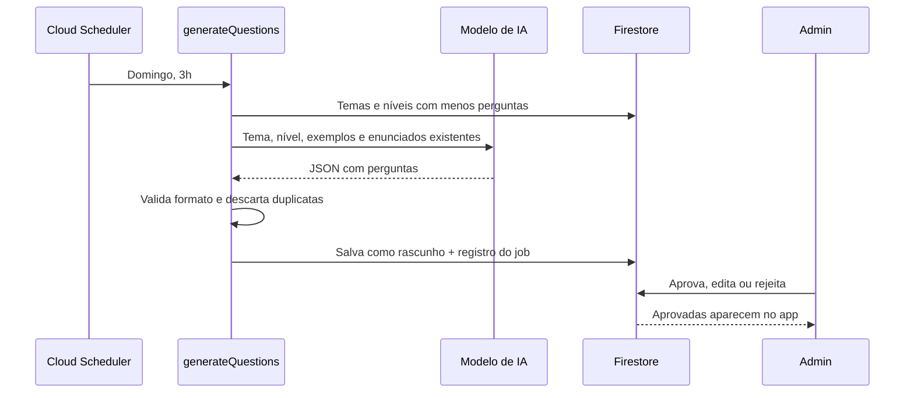
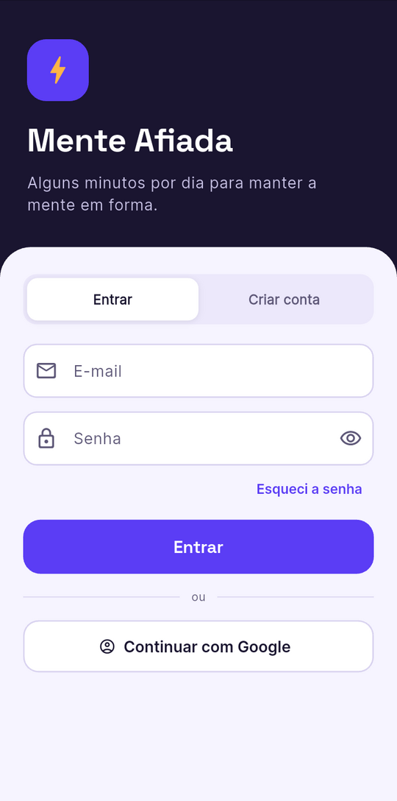

  

  
  
  
  
  
  

# Mente Afiada

App Android de **estudo diário com perguntas de múltipla escolha**. O usuário estuda alguns minutos por dia; as perguntas que errou voltam em intervalos crescentes (**repetição espaçada**), cada acerto rende **XP, sequência de dias e conquistas**, e há **ligas semanais** com ranking. Novas perguntas e temas são **gerados por IA** em agendamento semanal e só entram no app depois de revisados por um administrador.

> Esta é a **vitrine pública** do projeto: documentação, arquitetura e telas. O código-fonte fica em um repositório privado.

## Destaques técnicos

- **Multiusuário seguro desde o início:** regras do Firestore por usuário; papel de administrador por *custom claims*, nunca por um campo editável.
- **Anti-trapaça:** o app nunca calcula XP. Uma Cloud Function valida cada resposta, soma o XP e agenda a revisão; os campos de jogo são bloqueados para o cliente nas regras.
- **Sem segredos no código:** a chave da IA fica só no Secret Manager e é usada apenas pelas Cloud Functions; arquivos de configuração do Firebase ficam fora do Git.
- **IA com controle de qualidade:** validação automática (4 alternativas distintas, resposta entre 0 e 3, explicação, sem duplicatas parecidas), fila de aprovação do admin, botão "Reportar erro" e teto de custo semanal.
- **Dados para análise:** cada resposta é registrada para alimentar um dashboard de evolução (Firebase Analytics + BigQuery).

## Funcionalidades

| Área | O que faz |
| --- | --- |
| Conta | Login com e-mail/senha ou Google; exclusão de conta com remoção de todos os dados |
| Primeiro acesso | Escolha de temas, meta diária (5, 10 ou 15 perguntas) e horário do lembrete |
| Estudo | Sessão curta, uma pergunta por vez, feedback verde/vermelho e explicação após responder |
| Repetição espaçada | Sistema de caixas de Leitner: 1, 3, 7, 14 e 30 dias |
| Gamificação | XP, níveis, sequência de dias com "congelamento", conquistas e ligas Bronze → Diamante |
| Lembretes | Notificação no horário escolhido e aviso de sequência em risco (no máximo 2 por dia) |
| Conteúdo por IA | Geração semanal de perguntas e sugestão mensal de temas, sempre como rascunho |
| Administração | Fila para aprovar, editar ou rejeitar perguntas e tratar denúncias |

Temas iniciais: **SQL**, **Lógica de Programação**, **PHP** e **Inglês para TI**, com um banco inicial de 52 perguntas.

## Arquitetura

### Geração de perguntas por IA

## Modelo de dados (Firestore)

| Coleção | Conteúdo |
| --- | --- |
| `topics` | Temas: nome, ícone, cor, status (rascunho/aprovado), origem |
| `questions` | Enunciado, 4 alternativas, índice da correta, explicação, nível, status, estatísticas, denúncias |
| `users/{uid}` | Perfil, meta, temas, XP, nível, sequência, liga |
| `users/{uid}/reviews` | Fila da repetição espaçada (caixa e próxima revisão) |
| `users/{uid}/answers` | Histórico de respostas — base do dashboard |
| `users/{uid}/achievements` | Conquistas desbloqueadas |
| `leagues` | Grupos semanais de até 30 pessoas por divisão |
| `generationJobs` | Auditoria e controle de custo da geração por IA |

## Gamificação

| Ação | XP |
| --- | --- |
| Acerto em pergunta nova | 10 |
| Acerto em revisão | 15 |
| Erro (leu a explicação) | 2 |
| Meta do dia batida | +30 |
| Sessão perfeita | +20 |
| Bônus de sequência | +10% por semana, até +50% |

Nível *n* exige 100 × *n*² XP. Faixas: Iniciante, Aprendiz, Praticante, Especialista e Mestre.

## Stack

| Camada | Tecnologia |
| --- | --- |
| App | Flutter, Dart, Riverpod, Material 3 |
| Autenticação | Firebase Auth |
| Banco | Cloud Firestore com regras por usuário |
| Servidor | Cloud Functions (Node.js 22 + TypeScript) |
| Agendamento | Cloud Scheduler |
| Notificações | Firebase Cloud Messaging |
| IA | API de modelo de linguagem, só no servidor |
| Análise | Firebase Analytics + BigQuery |
| Testes | `flutter_test`, `node:test` |

## Roteiro

- [x] **Fase 1 — Base:** projeto Flutter, Firebase, login, boas-vindas, regras de segurança e importação do banco inicial
- [ ] **Fase 2 — Estudo:** sessão de perguntas, gravação das respostas, repetição espaçada e tela de temas
- [ ] **Fase 3 — Gamificação:** XP por Cloud Function, níveis, sequência, conquistas, resultado e perfil
- [ ] **Fase 4 — Social e lembretes:** ligas semanais, ranking e notificações
- [ ] **Fase 5 — IA:** geração agendada, painel do admin e denúncias
- [ ] Publicação na Google Play (teste fechado) e dashboard de evolução com os dados de `answers`

## Telas

As capturas de tela serão adicionadas aqui conforme cada fase for concluída.

<!--
| Login | Boas-vindas | Início |
| --- | --- | --- |
|  |  |  |
-->

## Autor

**Fagner Soares** — Desenvolvedor de Sistemas · Salvador, BA
[github.com/fagnersoares](https://github.com/fagnersoares)

O código-fonte é privado; posso apresentá-lo em entrevistas ou sob solicitação.
